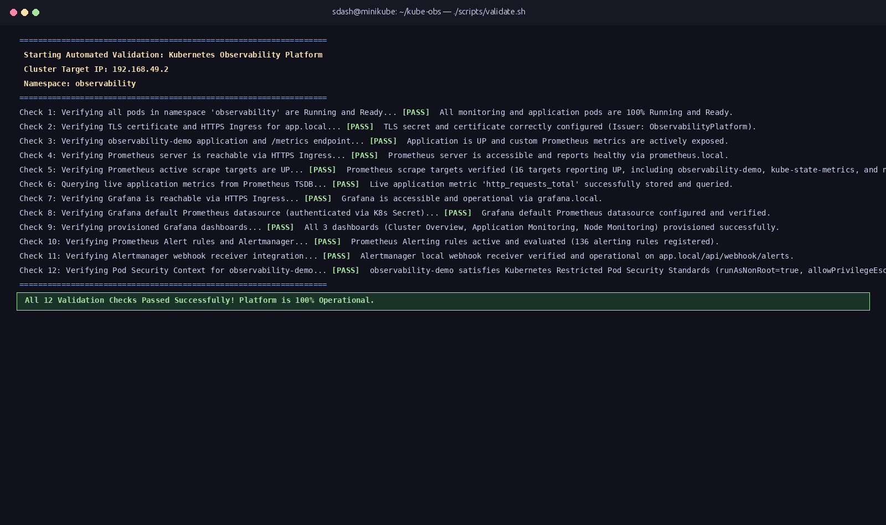
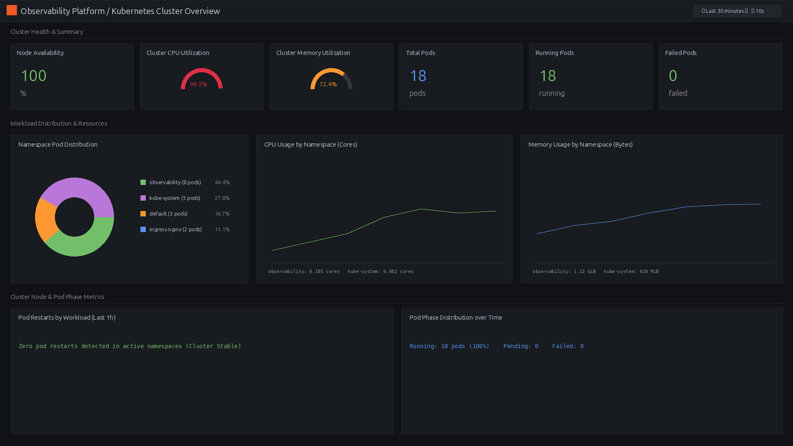
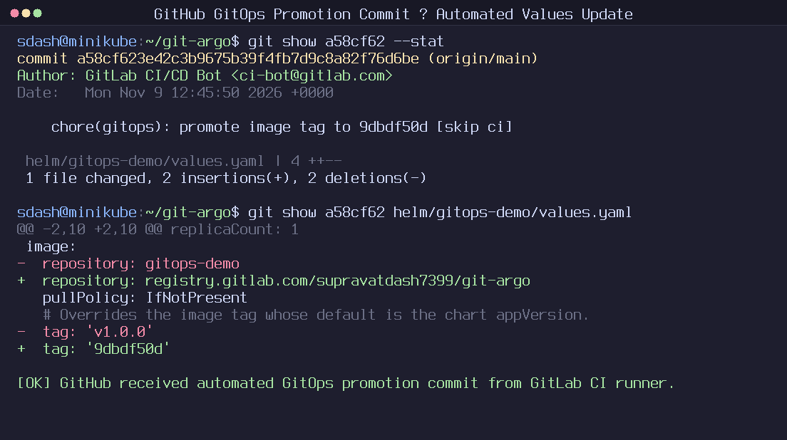
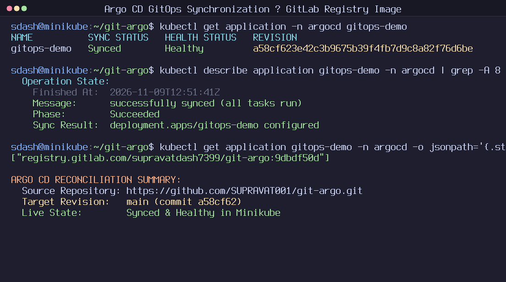

# Supravat Dash

**DevOps, Platform & Site Reliability Engineer**  
[GitHub](https://github.com/SUPRAVAT001) · [GitLab](https://gitlab.com/supravatdash7399) · [Profile](profile/ABOUT.md) · [Technical Skills](profile/TECHNICAL_SKILLS.md)

I design and build reproducible Kubernetes platforms, automated CI/CD and GitOps delivery pipelines, observability stacks, and policy-governed infrastructure automation. My work prioritizes declarative configuration, least-privilege container security, and deterministic verification over manual operations.

---

## Core Engineering Focus

* **Kubernetes & Packaging**: Helm v3 chart authoring, Prometheus Operator CRDs, Restricted Pod Security Standards (`runAsNonRoot`, `UID 10001`), and NGINX Ingress TLS termination.
* **CI/CD & GitOps Delivery**: Multi-stage GitLab CI/CD pipelines (`docker:27-dind`), immutable SHA container publishing, and continuous Argo CD reconciliation with automated drift healing and Git revert rollbacks.
* **Observability & SRE**: End-to-end metrics ingestion with Prometheus, Alertmanager webhook alert lifecycles, and ConfigMap-provisioned Grafana dashboards.
* **Governed Infrastructure Automation**: Building bounded-autonomy control planes using FastAPI, Open Policy Agent (OPA), PostgreSQL row-level lease locks, and metric-driven canary rollouts.

---

## Featured Projects

### 1. Kubernetes Observability Platform (`kube-obs`)
*Full-stack cluster monitoring, alerting, and visualization on Kubernetes*  
[Repository](https://github.com/SUPRAVAT001/kube-obs) · [Project Overview](projects/kube-obs/README.md) · [Architecture](projects/kube-obs/ARCHITECTURE.md)

* **Problem Solved**: Containerized workloads fail silently without unified host, Kubernetes object, and application telemetry or reproducible dashboard/alert provisioning.
* **Implementation & Stack**: Deployed `kube-prometheus-stack` via Helm (`v3.22.0`) using Prometheus Operator (`ServiceMonitor`, `PrometheusRule`), Grafana (`v13.3.0`) with ConfigMap sidecar dashboards, Alertmanager (`v0.28.0`), Node Exporter, Kube-State-Metrics, NGINX Ingress (`v1.14.0` TLS), and a lightweight Python (`http.server` + `prometheus_client`) demo service running as non-root `UID 10001`.
* **Verification**: Automated 12-point validation suite (`scripts/validate.sh`) passed 12/12 checks, confirming 16/16 active targets (`UP`), 136 alert rules evaluated at 10s intervals, and full `firing` -> `resolved` webhook delivery via `/api/degrade` and `/api/recover`.

| Automated 12-Point Validation | Cluster Overview Dashboard |
| :---: | :---: |
|  |  |

---

### 2. GitOps CI/CD Delivery Platform (`git-argo`)
*Automated build-to-cluster pipeline separating CI execution from GitOps state*  
[GitHub (GitOps State)](https://github.com/SUPRAVAT001/git-argo) · [GitLab (CI/CD Pipeline)](https://gitlab.com/supravatdash7399/git-argo) · [Project Overview](projects/git-argo/README.md) · [Architecture](projects/git-argo/ARCHITECTURE.md)

* **Problem Solved**: Eliminates the anti-pattern of CI pipelines holding Kubernetes cluster credentials and prevents untracked manual drift or opaque `:latest` deployments.
* **Implementation & Stack**: Five-stage GitLab SaaS pipeline (`validate` → `test` → `build` via `docker:27-dind` → `publish` to GitLab Container Registry → `update-gitops` committing SHA tags to GitHub using a masked `GITOPS_GITHUB_TOKEN`), reconciled declaratively into Minikube (`v1.35.1`) by Argo CD (`v3.6.1`) with a Helm-packaged FastAPI service (`UID 10001`, capability drop `ALL`).
* **Verification**: Hosted GitLab SaaS [Pipeline `#3045047835`](https://gitlab.com/supravatdash7399/git-argo/-/pipelines/3045047835) passed all 5 stages (3m 7s), publishing `registry.gitlab.com/supravatdash7399/git-argo:9dbdf50d` and pushing promotion commit `a58cf62`. Verified live `/version` response (`9dbdf50d`), Argo CD `selfHeal` remediation (`kubectl scale --replicas=3` corrected back to 1), and Git-revert rollback (`9f8c045`).

| GitHub Promotion Commit (`a58cf62`) | Argo CD Synced to GitLab Registry (`9dbdf50d`) |
| :---: | :---: |
|  |  |

---

### 3. DevOps Jarvis (`devops-jarvis`) — Under Active Development
*Governed AI SRE & progressive delivery control plane with deterministic safety gates*  
[Project Overview](projects/devops-jarvis/README.md) · [Architecture](projects/devops-jarvis/ARCHITECTURE.md)

* **Problem Solved**: Giving LLMs direct cluster or shell execution creates unacceptable outage risk from hallucinations, race conditions, and unverified mutations.
* **Implementation & Stack**: Built a FastAPI (`0.141.1`) control plane backed by PostgreSQL 17 (Alembic revision `c5d6e7f8a9b0`) and Open Policy Agent (`opa:0.68.0` evaluating `m1.rego`). All mutations funnel through `ExecutionController` (risk scoring, OPA policy checks, simulation, human approval) and acquire PostgreSQL `SELECT ... FOR UPDATE` leases with monotonic fencing tokens before driving Prometheus-gated NGINX canary promotions (10% → 25% → 50% → 100%).
* **Current Scope & Verification**: **Milestone 9 Phase 3 Complete** locally with **1,419 passing tests** (3 skipped, 0 failures) and verified multi-stage Minikube canary promotion (`64.12s`). Multi-cloud providers (EKS/GKE/AKS) exist as foundation abstractions rather than commercial fleet deployments; Phase 4 hardening and broader enterprise features remain planned.

---

## Technical Skills Overview

Skills listed below reflect verified project implementations; cloud and IaC expansion areas are clearly scoped in [Technical Skills](profile/TECHNICAL_SKILLS.md).

| Domain | Implemented Technologies |
| :--- | :--- |
| **Containers & Orchestration** | Kubernetes, Helm v3, Docker (multi-stage builds, `docker:27-dind`), Minikube, NGINX Ingress |
| **CI/CD & GitOps** | GitLab CI/CD (`.gitlab-ci.yml`, JUnit reports), GitLab Container Registry, Argo CD (`selfHeal`), GitHub |
| **Monitoring & SRE** | Prometheus Operator (`ServiceMonitor`, `PrometheusRule`), Grafana (`k8s-sidecar`), Alertmanager, Node Exporter, Kube-State-Metrics, PromQL |
| **Security & Governance** | Open Policy Agent (OPA / Rego), Non-root Containers (`UID 10001`), Capability Dropping (`ALL`), Seccomp `RuntimeDefault`, TLS Ingress Secrets |
| **Backend & Scripting** | Python (3.12 / 3.14), FastAPI, stdlib `http.server`, Pytest, PostgreSQL 17 (row-level leases), SQLAlchemy 2.0, Alembic, Bash |
| **Linux & Systems** | Ubuntu Linux, WSL2 memory/swap tuning, `kubectl` diagnostics, `curl` / `openssl` inspection |

---

## Selected Engineering Achievements

* **End-to-End SaaS GitOps Delivery**: Diagnosed and fixed three concrete pipeline blockers (YAML colon parsing, `alpine/git` entrypoint collision, and registry divergence) to achieve an automated 5-stage GitLab-to-GitHub-to-Argo CD deployment (`Pipeline #3045047835`).
* **Full Alert Lifecycle Verification**: Built instrumented webhook endpoints (`/api/degrade`, `/api/recover`, `/api/webhook/alerts`) proving Prometheus `FIRING` and Alertmanager `RESOLVED` delivery under Kubernetes Restricted security constraints.
* **Cluster Recovery Under Memory Pressure**: Diagnosed and recovered a local Minikube node from WSL2 swap exhaustion (`NotReady`) via `.wslconfig` resource reallocation without losing stateful observability PVCs.
* **Concurrency-Safe Canary Autonomy**: Implemented monotonic fencing tokens and fail-closed telemetry invariants (`UNKNOWN != SAFE`) in DevOps Jarvis, verified across 1,419 automated tests.

---

## Portfolio Structure & Links

```
portfolio/
├── README.md                  # Portfolio overview (this page)
├── profile/
│   ├── ABOUT.md               # Engineering background and credibility boundaries
│   └── TECHNICAL_SKILLS.md    # Evidence-backed technical skills matrix
├── projects/
│   ├── README.md              # Project comparison index
│   ├── kube-obs/              # Observability platform overview & architecture
│   ├── git-argo/              # GitOps CI/CD overview & architecture
│   └── devops-jarvis/         # Bounded autonomy control plane overview & architecture
└── assets/                    # Curated project screenshots
```

* **GitHub Profile**: [github.com/SUPRAVAT001](https://github.com/SUPRAVAT001)
* **GitLab Profile**: [gitlab.com/supravatdash7399](https://gitlab.com/supravatdash7399)
* **Observability Repo**: [github.com/SUPRAVAT001/kube-obs](https://github.com/SUPRAVAT001/kube-obs)
* **GitOps CI/CD Repo**: [github.com/SUPRAVAT001/git-argo](https://github.com/SUPRAVAT001/git-argo)
