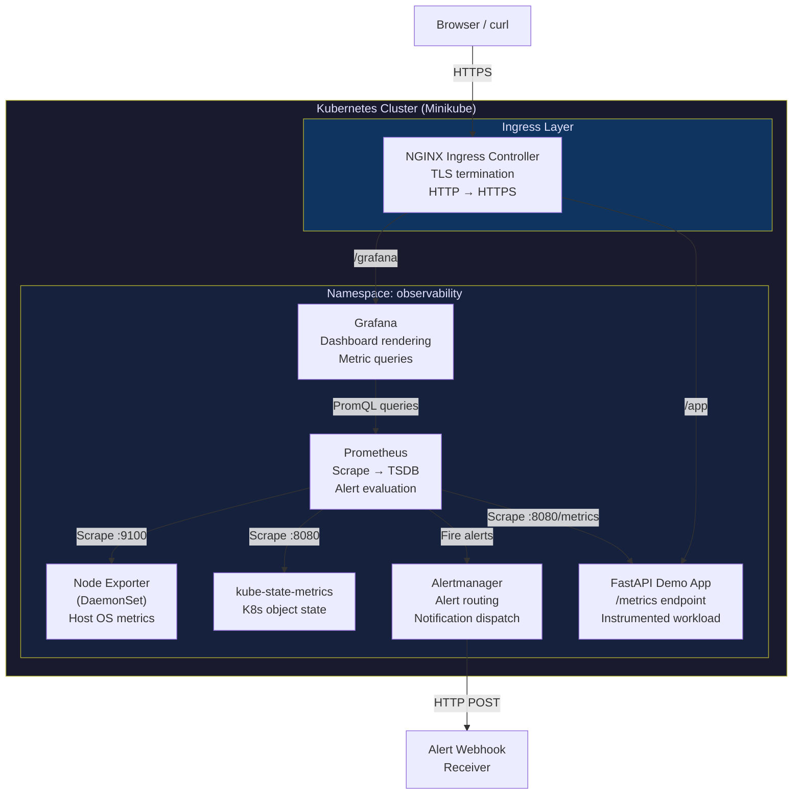
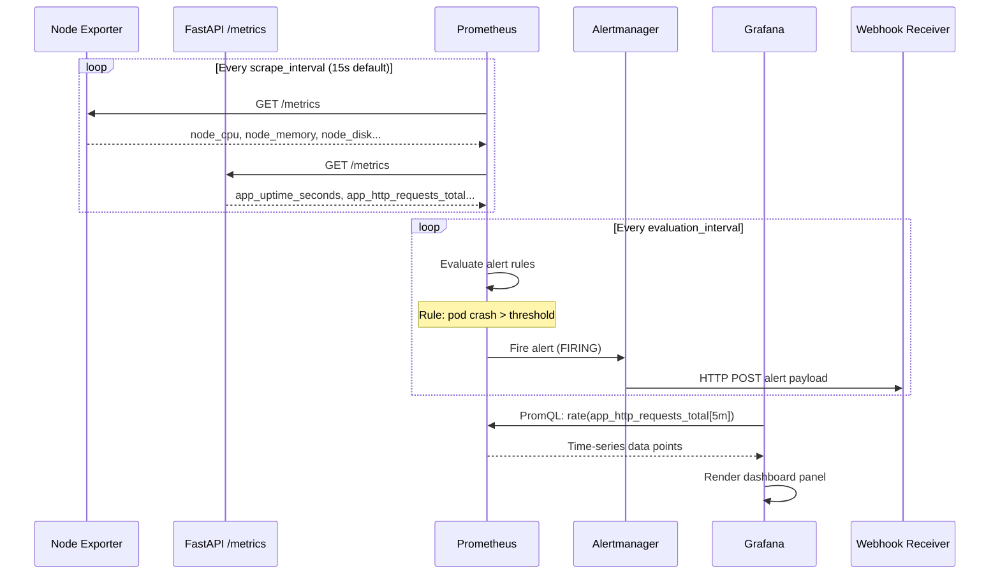
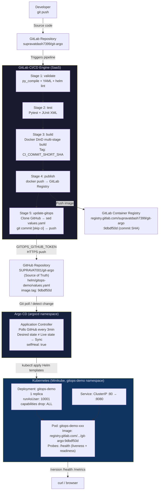
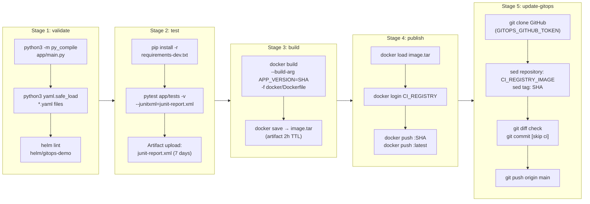
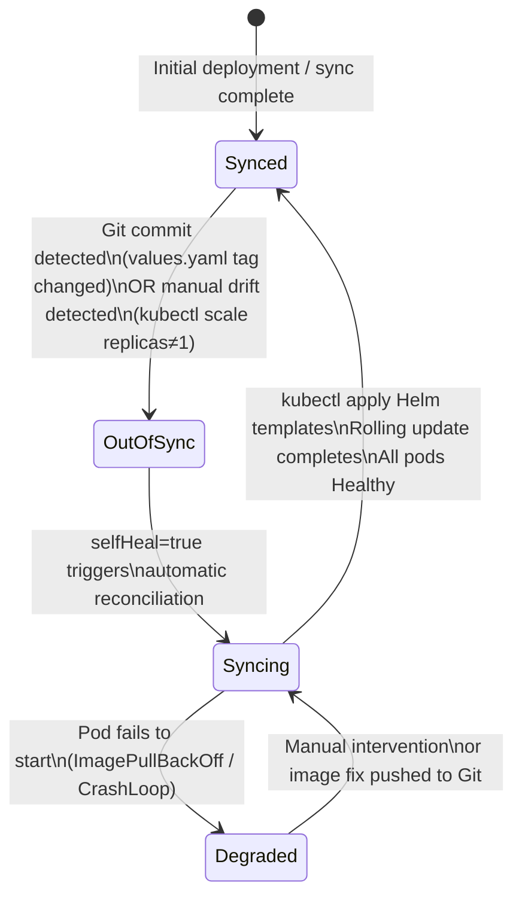
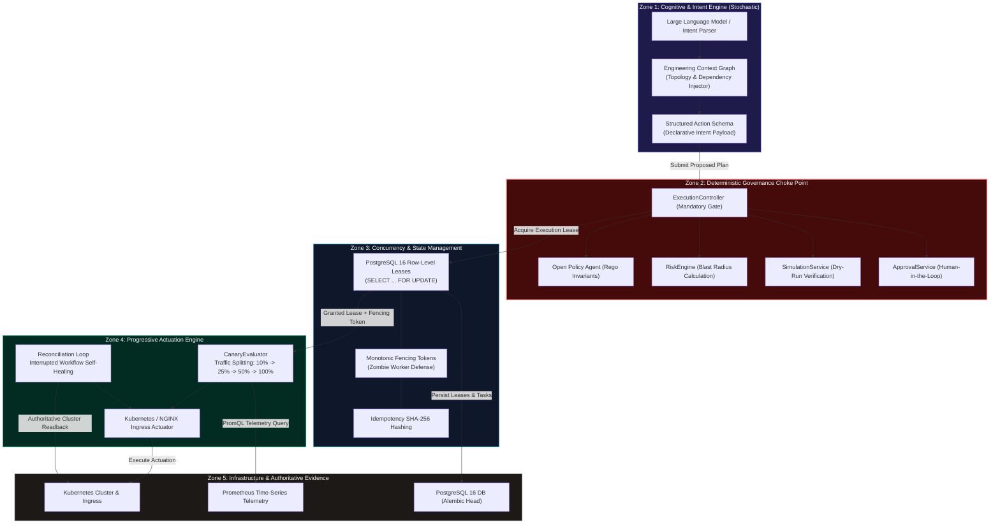

# Project Architecture Reference

Detailed technical architecture for both DevOps portfolio projects.

---

## Project 1: Kubernetes Observability Platform (`kube-obs`)

### Overview

A full-stack Kubernetes observability platform implementing the standard cloud-native monitoring pattern: metrics collection (Prometheus), alerting (Alertmanager), and visualization (Grafana), deployed on a self-managed Minikube cluster via Helm.

### Component Architecture



### Data Flow: Metrics Collection to Alert



### Key Technical Decisions (kube-obs)

| Decision | Rationale |
|----------|-----------|
| Prometheus Operator vs. raw Prometheus | Raw Prometheus used for direct control over `scrape_configs` and to avoid Operator CRD complexity on a single-node Minikube cluster |
| Helm chart packaging | All components packaged with Helm to enable reproducible `values.yaml`-driven configuration |
| Pod annotation-based discovery | `prometheus.io/scrape: "true"` on FastAPI pods enables automatic Prometheus target discovery without static config |
| NGINX Ingress with TLS | Demonstrates TLS termination in Kubernetes — a production requirement that is frequently a gap in demo setups |
| Controlled failure scenarios | Intentionally terminating pods to validate the full alert pipeline: Kubernetes event → Prometheus rule evaluation → Alertmanager → webhook |

### Resource Architecture

| Component | Type | Resource Profile |
|-----------|------|-----------------|
| Prometheus | StatefulSet (PVC) | High: stores TSDB metrics data |
| Alertmanager | Deployment | Low: stateless alert router |
| Grafana | Deployment (PVC) | Medium: dashboard rendering |
| kube-state-metrics | Deployment | Low: lightweight K8s API proxy |
| Node Exporter | DaemonSet | Low: host-level metric exposure |
| FastAPI Demo | Deployment | Very Low: instrumented demo workload |

---

## Project 2: GitOps CI/CD Delivery Platform (`git-argo`)

### Overview

A production-pattern GitOps delivery platform implementing strict separation between CI/CD concerns (GitLab) and deployment configuration concerns (GitHub + Argo CD). The core principle: the Kubernetes cluster state is always derived from Git — never from manual commands.

### Full System Architecture



### GitLab CI/CD Pipeline Architecture



### Argo CD Reconciliation Loop



### Container Security Architecture

```
Docker Multi-Stage Build (docker/Dockerfile)
├── Stage 1: builder (python:3.12-slim)
│   └── pip install --no-cache-dir → /app/wheels
│
└── Stage 2: runtime (python:3.12-slim)
    ├── COPY --chown=10001:10001 from builder
    ├── USER 10001 (non-root appuser)
    └── EXPOSE 8080

Kubernetes Pod Security (values.yaml)
├── podSecurityContext:
│   ├── runAsNonRoot: true
│   ├── runAsUser: 10001
│   ├── runAsGroup: 10001
│   ├── fsGroup: 10001
│   └── seccompProfile: RuntimeDefault
│
└── containerSecurityContext:
    ├── allowPrivilegeEscalation: false
    ├── readOnlyRootFilesystem: false
    └── capabilities.drop: [ALL]
```

### Application API Architecture

```
FastAPI Application (app/main.py)
│
├── Middleware: track_metrics()
│   └── Intercepts every request → increments REQUEST_COUNTS[method:path:status]
│
├── GET /                 → HTMLResponse (landing page) or JSONResponse (Accept: application/json)
│   └── Displays: APP_NAME, APP_VERSION, APP_ENV, GIT_COMMIT, GITOPS_TOOL, uptime
│
├── GET /health           → {"status":"healthy","timestamp":...,"version":...,"environment":...}
│   └── Used by: Kubernetes liveness probe (period: 10s) + readiness probe (period: 5s)
│
├── GET /version          → {"version":...,"environment":...,"git_commit":...,"gitops_managed":true}
│   └── Version injected via: ENV var APP_VERSION from Helm ConfigMap → Container env
│
└── GET /metrics          → Prometheus text format (Content-Type: text/plain; version=0.0.4)
    └── Exposes: app_uptime_seconds (gauge), app_info (gauge), app_http_requests_total (counter)

Configuration injection chain:
  Git commit SHA (CI_COMMIT_SHORT_SHA)
    → values.yaml image.tag
      → Argo CD applies Helm
        → ConfigMap APP_VERSION env var
          → Container environment
            → FastAPI os.getenv("APP_VERSION")
              → /version response body
```

### Infrastructure: Helm Chart Structure

```
helm/gitops-demo/
├── Chart.yaml                   # Chart metadata, version: 0.1.0, appVersion: 1.0.0
├── values.yaml                  # Configurable defaults (image, replicas, resources, probes)
└── templates/
    ├── _helpers.tpl             # name/label helper functions
    ├── deployment.yaml          # Deployment: securityContext, probes, envFrom ConfigMap
    ├── service.yaml             # ClusterIP: port 80 → targetPort 8080
    ├── configmap.yaml           # APP_NAME, APP_ENV, GITOPS_TOOL env vars
    ├── serviceaccount.yaml      # Dedicated SA, automountServiceAccountToken: false
    └── ingress.yaml             # Optional NGINX ingress (enabled: false by default)

Resource configuration (values.yaml):
  requests: cpu=50m,  memory=64Mi
  limits:   cpu=200m, memory=128Mi
```

### Namespace and Cluster Layout

```
Minikube Cluster (Kubernetes v1.35.1, single node, WSL2 Ubuntu)
│
├── Namespace: argocd
│   ├── argocd-server              (Argo CD API server + UI)
│   ├── argocd-application-controller (reconciliation loop)
│   ├── argocd-repo-server         (Git repository operations)
│   └── argocd-redis               (cache)
│
├── Namespace: gitops-demo
│   ├── Deployment: gitops-demo    (FastAPI microservice)
│   └── Service: gitops-demo       (ClusterIP)
│
├── Namespace: observability (kube-obs)
│   ├── prometheus-0               (StatefulSet)
│   ├── alertmanager-0             (StatefulSet)
│   ├── grafana-xxx                (Deployment)
│   ├── kube-state-metrics-xxx     (Deployment)
│   ├── node-exporter-xxx          (DaemonSet)
│   └── observability-demo-xxx     (FastAPI, 2 replicas)
│
└── Namespace: default
    └── (Jarvis staging: docker-compose, not K8s)
```

---

## Project 3: Autonomous AI SRE Control Plane (`devops-jarvis`)

### Overview

An autonomous AI DevOps and SRE control plane operating production cloud-native infrastructure through natural language while enforcing deterministic safety gates, risk evaluation, policy compliance, two-phase simulation, and human approval workflows.

### 5-Zone Bounded Autonomy Architecture



### Key Technical Decisions (devops-jarvis)

| Decision | Rationale |
|----------|-----------|
| Bounded Autonomy (Mandatory Choke Point) | LLMs cannot be trusted with raw mutation execution due to prompt injection and non-determinism. All actions must be validated by deterministic code. |
| Open Policy Agent (OPA/Rego) | Decouples compliance and safety rules from application code; allows declarative policy updates without recompiling the control plane. |
| PostgreSQL Row-Level Lease Locking | Avoids adding complex distributed consensus systems (e.g., etcd or Consul) when PostgreSQL is already an ACID-compliant requirement. |
| Monotonic Fencing Tokens | Solves the classic distributed split-brain problem when workers pause due to network latency or garbage collection. |
| Epistemic Invariants (`UNKNOWN != SAFE`) | Halts automated canary rollouts immediately if Prometheus metrics are missing, incomplete, or stale. |

---

> All architecture diagrams represent the actual implemented configuration as verified during project execution. No theoretical or aspirational components are included.

