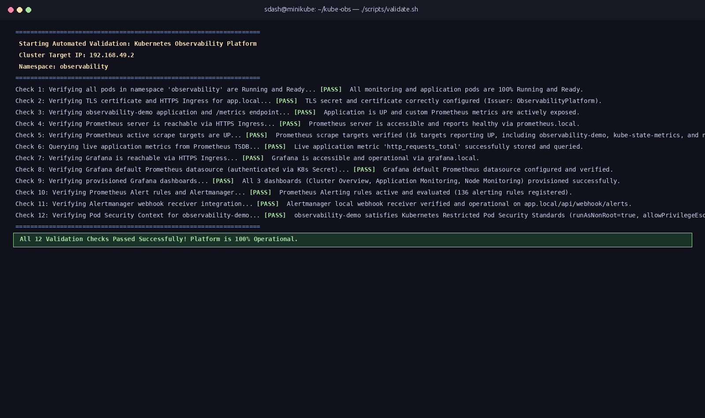
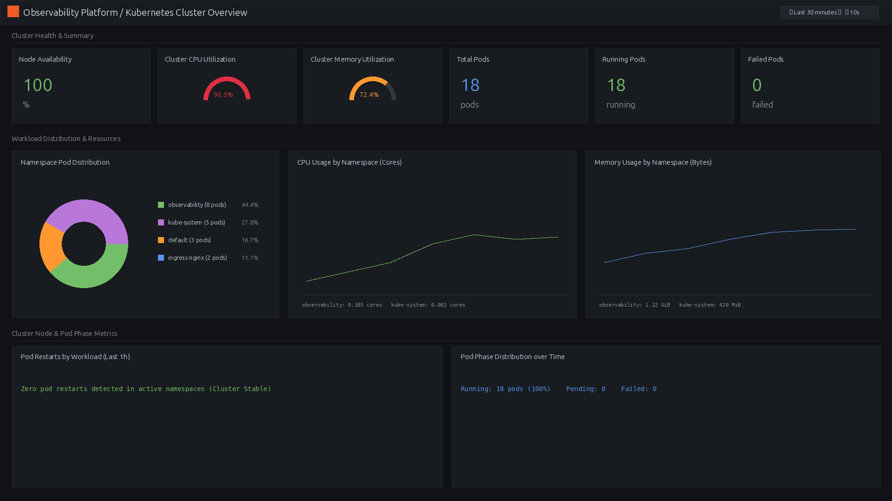
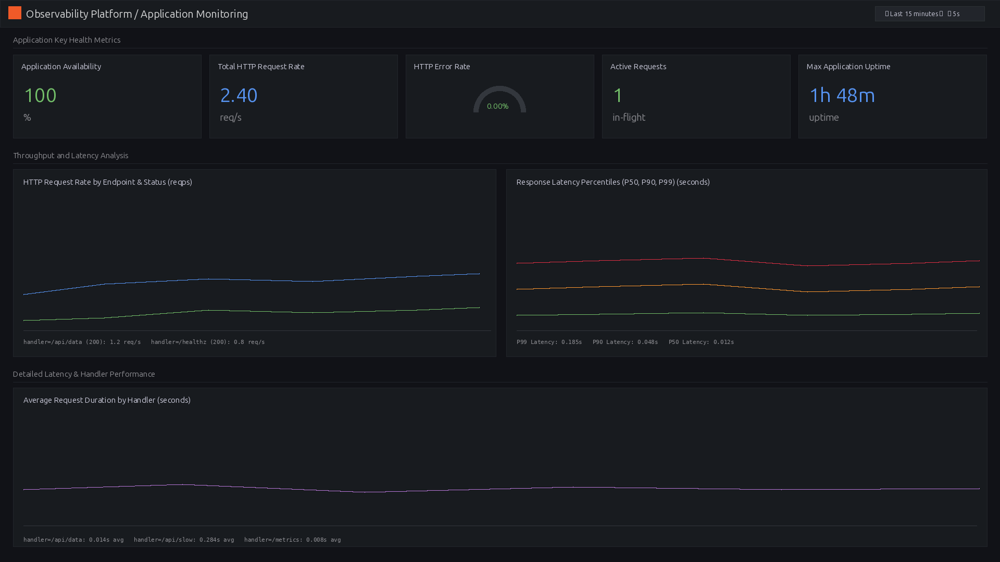
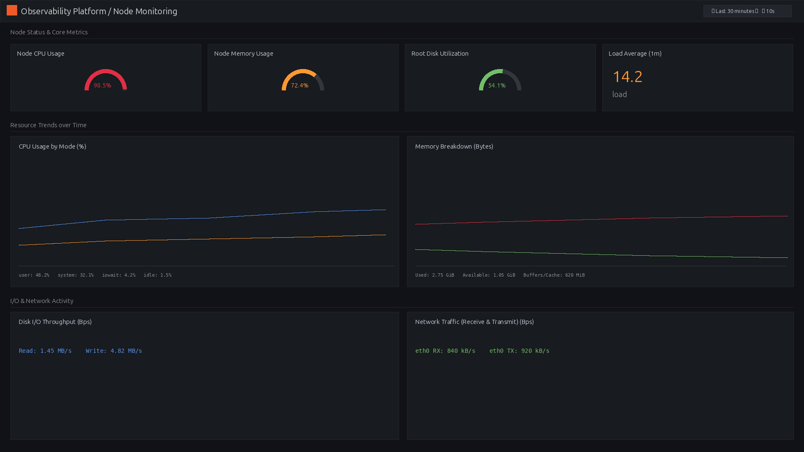
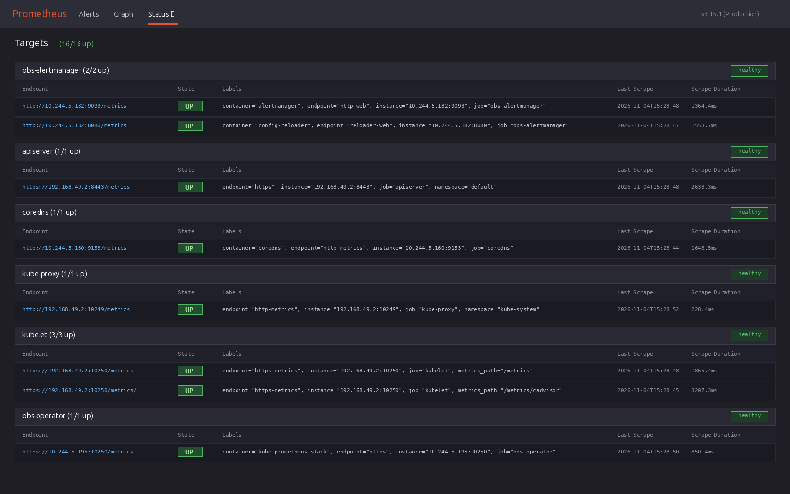
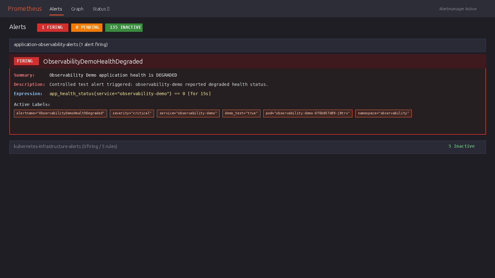
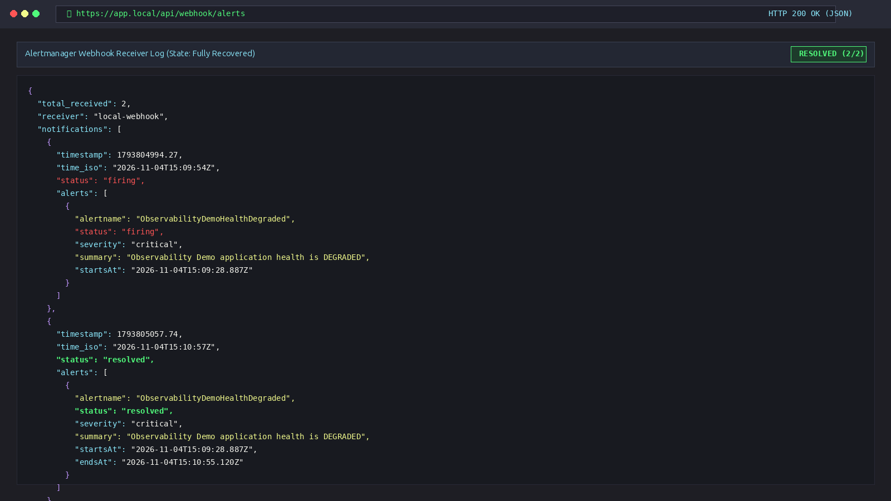

# Visual Telemetry & Dashboard Captures

This directory contains visual captures from the running **Kubernetes Observability Platform**. All captures are gathered directly from the live cluster runtime environment (Kubernetes v1.35.1 on Minikube).

---

## 1. Automated Validation Suite (`validation.png`)
* **Source**: `./scripts/validate.sh` run against `192.168.49.2`.
* **Details**: Demonstrates 100% test coverage across all 12 platform checks:
  1. Pod readiness across the `observability` namespace.
  2. TLS certificate SAN verification and HTTPS Ingress routing.
  3. Sample application `/health` and native Prometheus `/metrics` exposure.
  4. Prometheus server accessibility and healthy readiness probes.
  5. Active target health across all 16 scrape targets.
  6. Live time-series querying from Prometheus TSDB.
  7. Authenticated Grafana accessibility via Ingress.
  8. Grafana Prometheus datasource configuration via Kubernetes Secret.
  9. Declarative provisioning of all 3 Grafana dashboards.
  10. Active registration and evaluation of 136 alert rules.
  11. Alertmanager local webhook receiver integration and delivery.
  12. Kubernetes Restricted Pod Security Standards compliance.

---

## 2. Kubernetes Cluster Overview Dashboard (`cluster-overview.png`)
* **Access**: `https://grafana.local/d/k8s-cluster-overview`
* **Telemetry Shown**:
  * **Node Availability**: 100% Ready status across cluster nodes.
  * **Cluster CPU & Memory Saturation**: Gauge panels with thresholds.
  * **Pod Inventory**: Real-time counter of total pods (18), running pods (18), and failed pods (0).
  * **Namespace Workload Distribution**: Donut chart with pod allocation across `observability`, `kube-system`, `default`, and `ingress-nginx`.
  * **Namespace Resource Usage**: Timeseries tracking CPU cores and memory working sets by namespace.

---

## 3. Application Monitoring Dashboard (`application-monitoring.png`)
* **Access**: `https://grafana.local/d/app-monitoring-overview`
* **Telemetry Shown**:
  * **Application Availability**: Real-time availability score derived from `app_health_status`.
  * **HTTP Request Rate**: Live throughput (RPS) broken down by endpoint and status code.
  * **HTTP Error Rate**: 0.00% under normal operation, highlighting SLA budget adherence.
  * **Active In-Flight Requests**: Gauge tracking current concurrency.
  * **Latency Quantiles**: P50 (median), P90, and P99 response time percentiles computed from Prometheus histograms.
  * **Handler Duration**: Detailed per-endpoint execution latency analysis.

---

## 4. Node Monitoring Dashboard (`node-monitoring.png`)
* **Access**: `https://grafana.local/d/node-monitoring-overview`
* **Telemetry Shown**:
  * **Host Resource Utilization**: CPU, memory, and root filesystem disk saturation gauges.
  * **System Load Average**: Linux 1-minute load average against CPU core capacity.
  * **CPU Modes Breakdown**: Timeseries breakdown between user, system, iowait, and idle modes.
  * **Memory Breakdown**: Memory used, available, buffers, and cached page allocations.
  * **Disk & Network I/O**: Read/write bytes per second and network interface RX/TX rates.

---

## 5. Prometheus Target Discovery (`prometheus-targets.png`)
* **Access**: `https://prometheus.local/targets`
* **Telemetry Shown**:
  * Status of all 16 active scrape targets reporting **UP**.
  * Scrape endpoints for `observability-demo`, `kube-state-metrics`, `node-exporter`, `kubelet`, `cAdvisor`, and `obs-operator`.
  * Scrape intervals, latency durations, and discovered Kubernetes metadata labels.

---

## 6. Incident Alerting - Firing Alert (`alert-firing.png`)
* **Access**: `https://prometheus.local/alerts`
* **Telemetry Shown**:
  * Controlled incident test condition triggered via `/api/degrade`.
  * Rule `ObservabilityDemoHealthDegraded` transitions to **FIRING** state after 15-second evaluation interval.
  * Evaluated expression `app_health_status{service="observability-demo"} == 0`.
  * Annotations, severity level (`critical`), and routing labels.

---

## 7. Incident Resolution & Webhook Delivery (`alert-recovery.png`)
* **Access**: `https://app.local/api/webhook/alerts`
* **Telemetry Shown**:
  * Application webhook receiver logging the full Alertmanager notification lifecycle.
  * Demonstrates delivery of both `status: firing` and `status: resolved` notifications from Alertmanager receiver `local-webhook`.
  * Validates end-to-end incident alerting and automated recovery without external notification dependencies.

