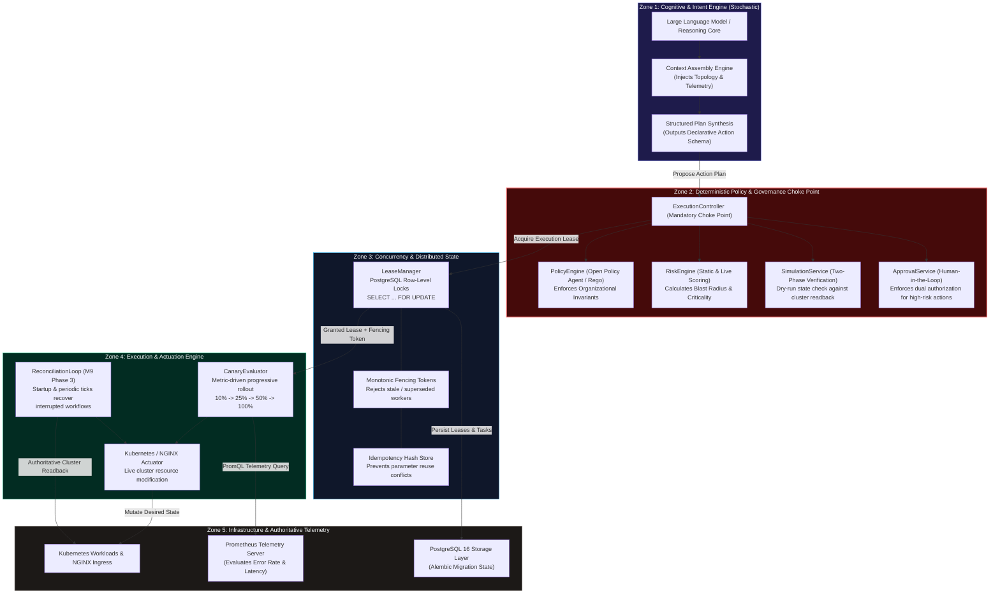

# Architecture: Autonomous AI SRE Control Plane (`devops-jarvis`)

A detailed architectural specification of the 5-zone bounded autonomy framework, deterministic safety choke points, and distributed lease locking.

---

## 1. Five-Zone Bounded Autonomy Architecture

---

## 2. Deterministic Safety Choke Point (`ExecutionController`)

The mandatory execution gate operates as an immutable state machine where **any single rejection halts the entire mutation**:

1. **Policy Gate (`PolicyEngine`)**:
   * Evaluates declarative Rego rules via Open Policy Agent.
   * Guarantees organizational compliance: forbids mutating production during freeze windows, forbids deploying containers with root execution contexts, forbids modifications to reserved control plane namespaces (`kube-system`, `argocd`, `observability`).
2. **Risk Assessment (`RiskEngine`)**:
   * Computes a deterministic blast-radius score based on target workload replica count, historical failure rates, service dependency depth, and environment tier (Production vs. Staging vs. Development).
3. **Pre-Execution Simulation (`SimulationService`)**:
   * Runs dry-run operations against current cluster state to verify that preconditions remain true (e.g., target deployment exists, target namespace is accessible, cluster has sufficient allocatable CPU/memory).
4. **Human-in-the-Loop Gate (`ApprovalService`)**:
   * High-risk operations (e.g., terminating multi-replica deployments or modifying core networking) generate approval requests. Execution remains paused until cryptographically signed authorization is provided.

---

## 3. Distributed Concurrency & Monotonic Fencing

To prevent split-brain execution across multiple worker nodes or event loops, the control plane implements a lease locking pattern:

* **PostgreSQL Row-Level Locks**: Workflows acquire execution leases using `SELECT ... FOR UPDATE` transactions with strictly bounded TTLs.
* **Monotonic Fencing Tokens**: Each lease grant increments an integer fencing token. If a worker experiences a long GC pause or network partition, its lease expires. When the zombie worker attempts to commit its result, the database rejects the transaction because a newer fencing token has superseded it.
* **Idempotency Hashing**: Every intent payload is hashed using SHA-256. Replay attempts within the deduplication window return the cached execution contract rather than spawning redundant operations.

---

## 4. Autonomous Progressive Delivery & Epistemic Invariants

During canary rollouts (Milestone 9 Phase 1), the autonomous loop progressively advances traffic through stages (10% → 25% → 50% → 100%):
* **Canary Evaluation**: The `CanaryEvaluator` queries live Prometheus time-series metrics (`http_requests_total`, `request_duration_seconds`).
* **Epistemic Invariant 1: `UNKNOWN != SAFE`**: If Prometheus is unreachable or returns empty metric sets, the evaluator immediately treats the state as unsafe and halts promotion.
* **Epistemic Invariant 2: `STALE != FRESH`**: If the last received metric sample exceeds the freshness window (60s), the rollout pauses until fresh telemetry confirms stability.
* **Automated Rollback**: If the error rate exceeds the defined threshold (e.g., > 1%) or latency p99 exceeds the budget during any stage, traffic is instantly rolled back to 0% canary weight.

