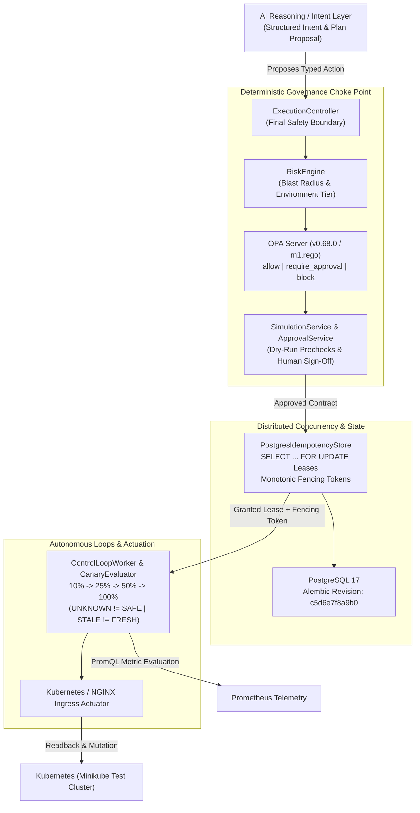

# Architecture: DevOps Jarvis Control Plane

[Project Overview](README.md)

---

## Bounded Autonomy Control Flow

---

## Core Technology Stack

| Layer | Component | Role |
| :--- | :--- | :--- |
| **Control Plane API** | Python (`>=3.14`), FastAPI (`0.141.1`), Pydantic (`2.13.5`) | Async REST control plane, Pydantic schema contracts, background reconciliation loops |
| **Policy Engine** | Open Policy Agent (`openpolicyagent/opa:0.68.0`) | Evaluates `deployments/opa/policies/m1.rego` (`low`/`medium` allow, `high`/prod require approval, `critical` block) |
| **State & Leases** | PostgreSQL 17, SQLAlchemy `2.0.44`, Alembic `1.17.2` | Multi-tenant persistence, row-level distributed lease locks, monotonic fencing tokens |
| **Infrastructure & Telemetry** | Kubernetes Python Client (`36.0.3`), NGINX Ingress, Prometheus | Canary routing annotations, live Prometheus metric queries, authoritative cluster state readback |
| **Staging & Verification** | Docker Compose (`api`, `postgres`, `opa`), Pytest (`9.1.1`) | 3-container staging stack and 1,419 automated unit, integration, and browser QA tests |

---

## Key Architectural Invariants

1. **No Direct AI Actuation**: LLM calls (`anthropic` SDK) only extract structured intent and synthesize advisory plans; only typed actions validated by `ExecutionController` reach cluster executors.
2. **Fail-Closed Policy & Actuation Defaults**: `JARVIS_ALLOW_LIVE_CANARY_ACTUATION="false"` and `JARVIS_OPA_FALLBACK_ENABLED="false"` in staging ensure unreachable OPA or unconfigured flags deny mutations cleanly.
3. **Monotonic Fencing & Idempotency**: Every lease claim assigns an incrementing `fencing_token` and validates compound ownership (`owner_id`, `status == IN_PROGRESS`, `fencing_token`) before committing state updates, blocking delayed zombie workers.
4. **Epistemic Canary Safety**: Canary progression halts (`INCONCLUSIVE` / pause) when Prometheus returns insufficient samples (`< min_samples`) or stale telemetry (`STALE != FRESH`), and aborts immediately on error-rate spikes (`ABORT_AND_RECOVER`).
