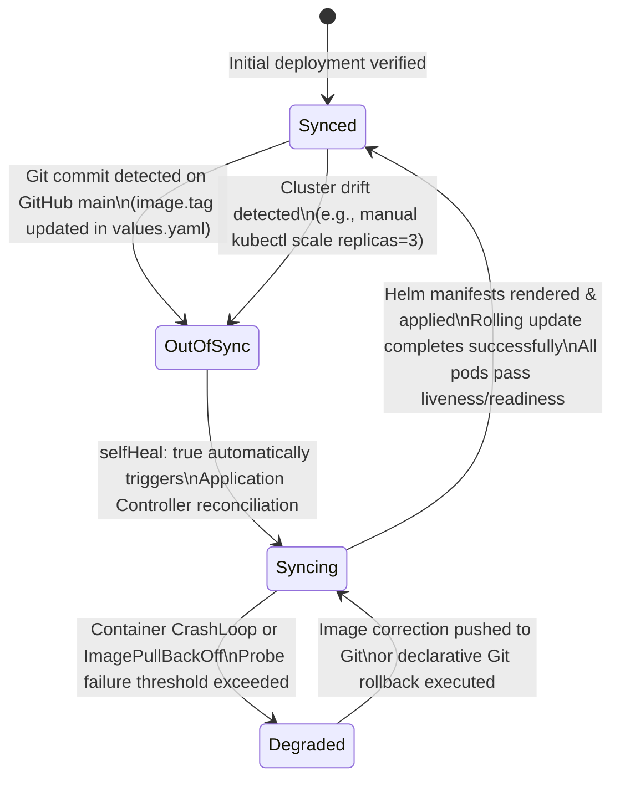

# Architecture: GitOps CI/CD Delivery Platform (`git-argo`)

A comprehensive architectural specification covering CI DAG pipelines, Docker-in-Docker isolation, GitHub promotion mechanisms, and Argo CD reconciliation state machines.

---

## 1. End-to-End System Architecture

```mermaid
flowchart TD
    DEV["Developer / Engineer\ngit push to origin/main"] -->|Push Source Code| GL_SRC["GitLab Source Repository\n(supravatdash7399/git-argo)"]

    subgraph GitLabCI["GitLab CI/CD SaaS Engine (Pipeline Runner)"]
        direction TB
        S1["Stage 1: validate\n• python3 -m py_compile app/main.py\n• python3 yaml.safe_load manifests\n• helm lint helm/gitops-demo"]
        S2["Stage 2: test\n• PYTHONPATH=. pytest app/tests\n• Export junit-report.xml artifact"]
        S3["Stage 3: build (docker:27-dind)\n• docker build --build-arg APP_VERSION=SHA\n• Save artifact: .build-cache/image.tar"]
        S4["Stage 4: publish (docker:27-dind)\n• docker load image.tar\n• docker push registry:SHA\n• docker push registry:latest"]
        S5["Stage 5: update-gitops (alpine/git)\n• git clone GitHub using GITOPS_GITHUB_TOKEN\n• sed update image.tag & repository in values.yaml\n• git commit [skip ci] & git push"]

        S1 --> S2 --> S3 --> S4 --> S5
    end

    GL_SRC -->|Trigger Webhook| GitLabCI

    S4 -->|Publish Immutable Image| REGISTRY["GitLab Container Registry\nregistry.gitlab.com/supravatdash7399/git-argo:9dbdf50d"]

    S5 -->|Update Deployment State| GH_REPO["GitHub GitOps Repository (Source of Truth)\nSUPRAVAT001/git-argo\nhelm/gitops-demo/values.yaml (tag: 9dbdf50d)"]

    subgraph ArgoCD["Argo CD Control Plane (Namespace: argocd)"]
        CTRL["Application Controller (gitops-engine)\n• Polls GitHub every 3m (or webhook)\n• Compares desired Git state vs live K8s state\n• Enforces automated self-healing & sync"]
    end

    GH_REPO -->|Git Poll / Webhook| ArgoCD

    subgraph K8s["Kubernetes Cluster (Namespace: gitops-demo)"]
        DEPLOY["Deployment: gitops-demo\n• 1 Replica (HA Ready)\n• Security: UID 10001, drop ALL\n• Probes: Liveness & Readiness"]
        POD["Pod: gitops-demo-77fd959cc8-ptdll\nImage: registry.gitlab.com/...:9dbdf50d"]
        SVC["Service: gitops-demo\nClusterIP: Port 80 -> 8080"]
        
        DEPLOY --> POD
        SVC --> POD
    end

    ArgoCD -->|Declarative Reconciliation\n(kubectl apply Helm templates)| K8s
    POD -->|Serve Endpoints\n/, /health, /version, /metrics| CLIENT["HTTP Clients / Prometheus Scrapers"]

    style GitLabCI fill:#1e1b4b,stroke:#818cf8,stroke-width:1px,color:#f8fafc
    style ArgoCD fill:#0f172a,stroke:#38bdf8,stroke-width:2px,color:#f8fafc
    style K8s fill:#022c22,stroke:#10b981,stroke-width:1px,color:#f8fafc
```

---

## 2. Five-Stage GitLab CI/CD Pipeline Architecture

The pipeline ([`.gitlab-ci.yml`](https://github.com/SUPRAVAT001/git-argo/blob/main/.gitlab-ci.yml)) executes five sequential quality gates:

1. **`lint-and-validate` (Stage: `validate`)**:
   * Image: `python:3.12-slim`
   * Installs Helm v3 and PyYAML.
   * Compiles Python bytecodes (`python3 -m py_compile app/main.py`) to detect syntax errors prior to runtime.
   * Validates YAML structure of all Helm values and Argo CD manifests.
   * Executes `helm lint helm/gitops-demo` to ensure chart syntax conformity.
2. **`unit-tests` (Stage: `test`)**:
   * Image: `python:3.12-slim`
   * Runs the Pytest suite against all API endpoints using FastAPI's `TestClient`.
   * Exports JUnit XML reports (`--junitxml=junit-report.xml`) ingested directly into GitLab CI test reporting.
3. **`build-image` (Stage: `build`)**:
   * Image: `docker:27-cli` with `docker:27-dind` service over mTLS.
   * Builds the multi-stage unprivileged Docker image tagged with `${CI_COMMIT_SHORT_SHA}`.
   * Archives `image.tar` into a 2-hour GitLab CI cache artifact.
4. **`publish-image` (Stage: `publish`)**:
   * Image: `docker:27-cli` with `docker:27-dind`.
   * Authenticates to GitLab Container Registry (`CI_REGISTRY`) using short-lived CI tokens.
   * Pushes the verified immutable image tag and latest alias.
5. **`promote-gitops` (Stage: `update-gitops`)**:
   * Image: `alpine/git:2.45.2` (with `entrypoint: [""]` override).
   * Clones the GitHub GitOps repository using the protected, masked `GITOPS_GITHUB_TOKEN`.
   * Programmatically updates `image.repository` and `image.tag` inside `helm/gitops-demo/values.yaml`.
   * Commits using `GitLab CI/CD Bot` with `[skip ci]` and pushes directly to GitHub `main`.

---

## 3. Argo CD Continuous Reconciliation Loop



---

## 4. Container Security & Privilege Separation

The application runtime enforces defense-in-depth security:

```yaml
# Pod Security Context
podSecurityContext:
  runAsNonRoot: true
  runAsUser: 10001
  runAsGroup: 10001
  fsGroup: 10001
  seccompProfile:
    type: RuntimeDefault

# Container Security Context
securityContext:
  allowPrivilegeEscalation: false
  readOnlyRootFilesystem: false
  capabilities:
    drop:
      - ALL

# ServiceAccount Least Privilege
serviceAccount:
  create: true
  automount: false # Eliminates token exposure to the pod
```

