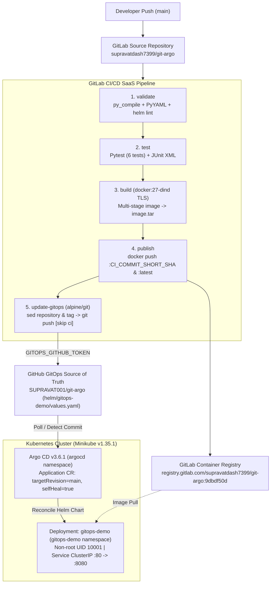
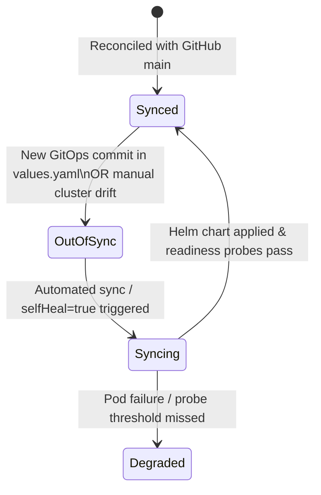

# Architecture: GitOps CI/CD Delivery Platform (`git-argo`)

[Project Overview](README.md) · [GitHub Repo](https://github.com/SUPRAVAT001/git-argo) · [GitLab CI/CD](https://gitlab.com/supravatdash7399/git-argo)

---

## End-to-End Delivery Workflow

---

## Key Design Decisions

| Component | Decision | Rationale |
| :--- | :--- | :--- |
| **CI vs. GitOps Split** | GitLab runs builds/registry; GitHub holds Helm state | Separates CI execution secrets from cluster deployment history; CI never receives Kubernetes cluster credentials. |
| **Immutable Tagging** | `${CI_COMMIT_SHORT_SHA}` across build & `values.yaml` | Enables exact code-to-pod traceability and deterministic rollback by Git commit revert. |
| **Argo CD Sync Policy** | `selfHeal: true`, `prune: false`, `ApplyOutOfSyncOnly=true` | Automatically reverts manual configuration drift (`kubectl scale`/`edit`) while guarding against accidental deletion of unmanaged objects during local iteration. |
| **Lean Argo CD Profile** | `dex.enabled: false`, `notifications.enabled: false`, `applicationSet.replicas: 0` | Fits Argo CD cleanly alongside the co-located `kube-obs` stack on a memory-constrained Minikube node (`controller` 128Mi req / 256Mi limit). |
| **Version Injection** | `APP_VERSION` injected via Helm `deployment.yaml` from `.Values.image.tag` | Ensures `/version` telemetry dynamically reflects the deployed GitOps SHA tag at runtime. |

---

## Argo CD Reconciliation State Machine

---

## Container & Pod Security Profile

* **Multi-Stage Dockerfile (`python:3.12-slim`)**: Compiles Python dependencies in a `builder` stage and copies only the virtual environment (`/opt/venv`) and source files into the unprivileged `runner` image (`USER 10001:10001`).
* **Pod Security Context**: `runAsNonRoot: true`, `runAsUser: 10001`, `runAsGroup: 10001`, `fsGroup: 10001`, `seccompProfile.type: RuntimeDefault`.
* **Container & SA Hardening**: `allowPrivilegeEscalation: false`, `capabilities.drop: [ALL]`, `serviceAccount.automount: false`, and strict resource boundaries (`50m`/`64Mi` requests, `200m`/`128Mi` limits).
