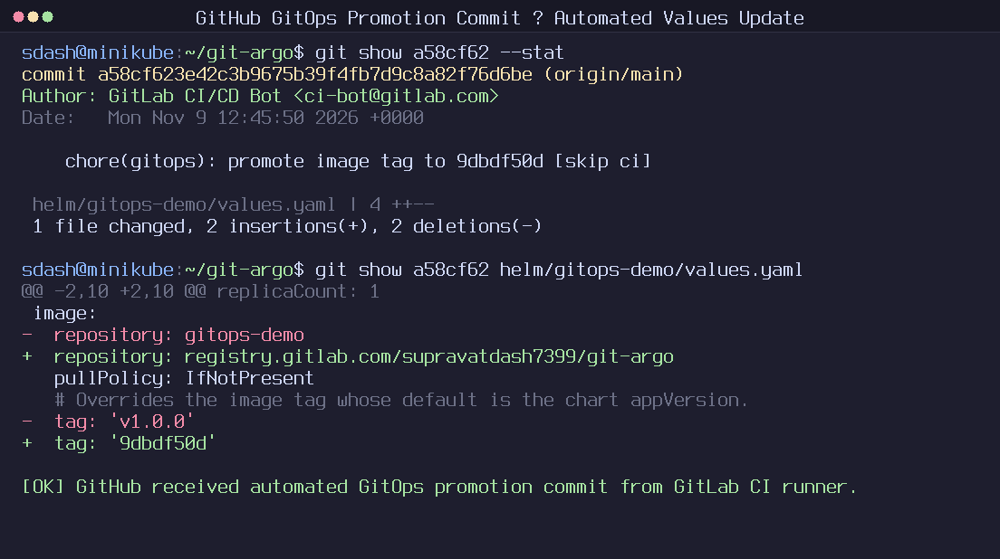
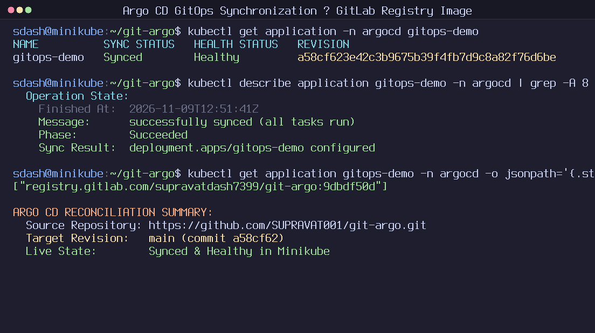
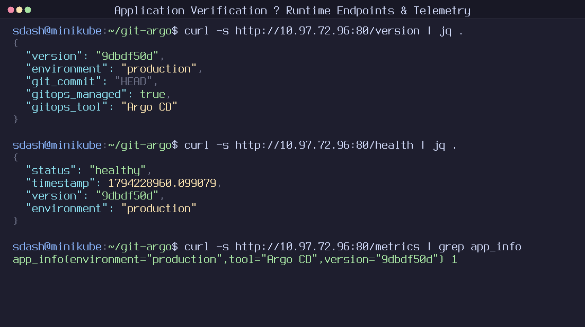
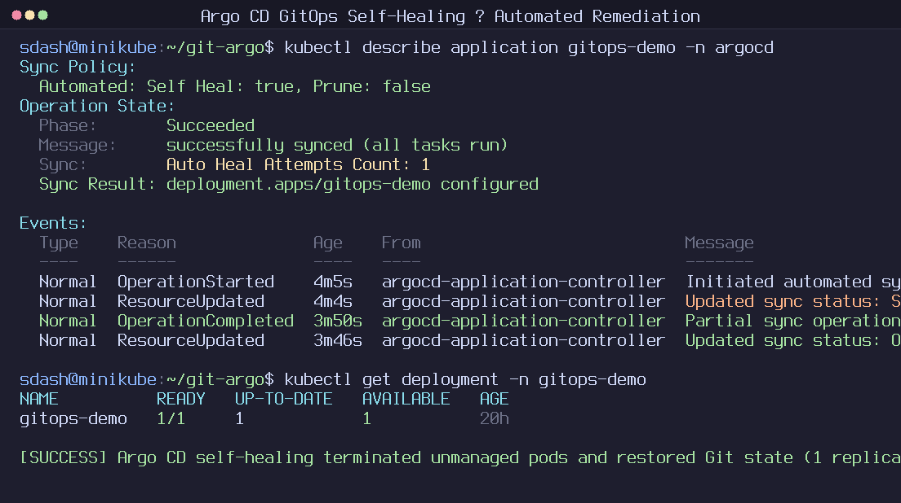
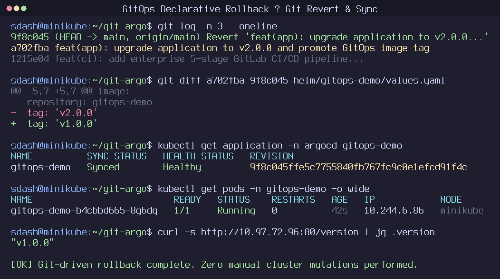

# GitOps CI/CD Delivery Platform (`git-argo`)

**GitHub (GitOps Source of Truth)**: [github.com/SUPRAVAT001/git-argo](https://github.com/SUPRAVAT001/git-argo)  
**GitLab (CI/CD & Container Registry)**: [gitlab.com/supravatdash7399/git-argo](https://gitlab.com/supravatdash7399/git-argo)  
**Architecture**: [Architecture Specification](ARCHITECTURE.md)  
**Status**: Live Hosted Pipeline Verified ([Pipeline #3045047835](https://gitlab.com/supravatdash7399/git-argo/-/pipelines/3045047835))

---

## Problem Statement

Traditional CI pipelines frequently push directly to Kubernetes using imperative `kubectl` or `helm` commands, forcing CI runners to store high-privilege cluster credentials and allowing live cluster configuration drift to go unnoticed. Meanwhile, mutable image tags like `:latest` obscure exact code versions and complicate rollbacks.

`git-argo` separates continuous integration (GitLab) from deployment state (GitHub) so Argo CD continuously reconciles Kubernetes strictly from Git using immutable commit SHA image tags.

---

## Verified Delivery Highlights

* **Hosted Five-Stage GitLab SaaS Pipeline (`#3045047835`)**:
  1. `validate` (`lint-and-validate`, 33.0s): Python `py_compile`, YAML structural validation, and `helm lint`.
  2. `test` (`unit-tests`, 25.7s): 6 Pytest API endpoint tests exporting `junit-report.xml`.
  3. `build` (`build-image`, 60.2s): Multi-stage unprivileged Docker build via `docker:27-dind` (mTLS), tagged `${CI_COMMIT_SHORT_SHA}` (`9dbdf50d`).
  4. `publish` (`publish-image`, 46.6s): Pushed immutable `registry.gitlab.com/supravatdash7399/git-argo:9dbdf50d` and `:latest` to GitLab Container Registry.
  5. `update-gitops` (`promote-gitops`, 21.7s): Updated both `image.repository` and `image.tag` in GitHub `helm/gitops-demo/values.yaml` via masked/protected `GITOPS_GITHUB_TOKEN`, committing `a58cf62` with `[skip ci]`.
* **Argo CD Reconciliation & Self-Healing**: Argo CD (`v3.6.1`) automatically detected `a58cf62` and rolled out the GitLab Registry container image into Minikube (`GET /version` returns `9dbdf50d`; `GET /health` HTTP 200).
* **Out-of-Band Drift Detection**: Manual scaling (`kubectl scale deployment gitops-demo --replicas=3`) triggered immediate `OutOfSync` detection and automatic remediation (`Auto Heal Attempts Count: 1`) back to 1 replica.
* **Declarative Git Rollback**: Executed zero-downtime rollback from `v2.0.0` to `v1.0.0` purely via `git revert a702fba` (`9f8c045`).
* **Offline Local CI Harness**: [`scripts/local-ci-simulate.sh`](https://github.com/SUPRAVAT001/git-argo/blob/main/scripts/local-ci-simulate.sh) validates all five pipeline stages locally without external runner access.

---

## Real Pipeline Issues Diagnosed & Fixed

1. **YAML Colon-Parser Collision (Commit `1fda3f5`)**: Unquoted `echo "==> ...: ${TAG}"` strings in `.gitlab-ci.yml` triggered GitLab YAML key parsing failures; resolved by single-quoting YAML script lines containing colons.
2. **`alpine/git` Entrypoint Conflict (Commit `9dbdf50`)**: `alpine/git:2.45.2` sets `ENTRYPOINT ["/usr/bin/git"]`, causing GitLab's shell runner to fail with `git: 'sh' is not a git command`; fixed with `entrypoint: [""]`.
3. **Registry Repository Divergence (Commit `2376a62`)**: Updating only `image.tag` in `values.yaml` left `image.repository: gitops-demo` pointing to DockerHub instead of `CI_REGISTRY_IMAGE`; expanded Stage 5 `sed` updates to promote both repository and tag cleanly.

---

## Verified Evidence

### Automated GitOps Promotion & Argo CD Reconciliation (`9dbdf50d`)
| GitHub Promotion Commit (`a58cf62`) | Argo CD Synced to GitLab Image | Live `/version`, `/health` & `/metrics` |
| :---: | :---: | :---: |
|  |  |  |

### Drift Self-Healing & Declarative Git Rollback
| Automated Self-Healing (`Auto Heal Attempts: 1`) | Declarative Git Revert Rollback (`9f8c045`) |
| :---: | :---: |
|  |  |

---

> Source code, Dockerfile, Helm templates, Argo CD manifests, and the offline CI simulation script are available in [github.com/SUPRAVAT001/git-argo](https://github.com/SUPRAVAT001/git-argo).

