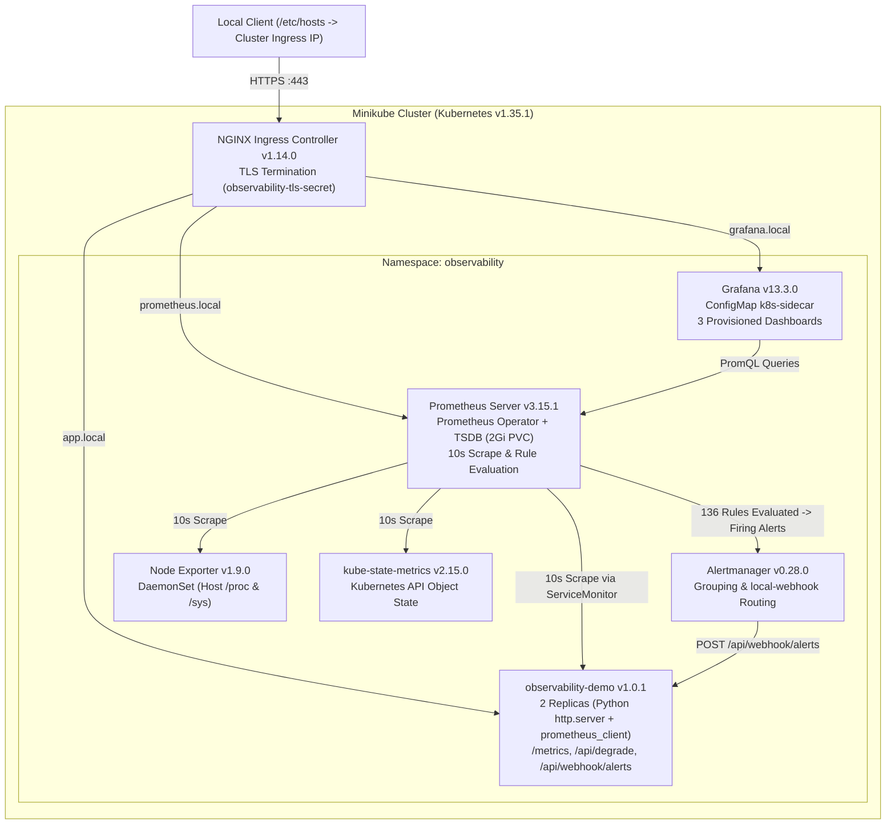
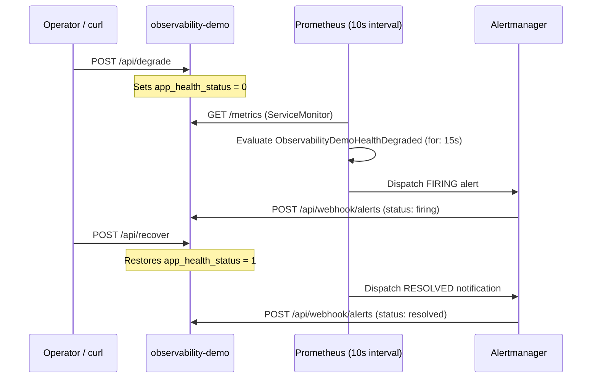

# Architecture: Kubernetes Observability Platform (`kube-obs`)

[Project Overview](README.md) · [Source Repository](https://github.com/SUPRAVAT001/kube-obs)

---

## System Architecture

---

## Component Stack

| Layer | Component | Version | Role |
| :--- | :--- | :--- | :--- |
| **Orchestration** | Kubernetes (Minikube) | v1.35.1 | Single-node cluster orchestration |
| **Packaging** | Helm (`kube-prometheus-stack`) | v3.22.0 | Declarative Prometheus Operator & stack deployment |
| **Metrics & TSDB** | Prometheus Server | v3.15.1 | Time-series scraping, 2Gi PVC TSDB, 136 alert rules |
| **Visualization** | Grafana | v13.3.0 | PromQL dashboards auto-synced via `k8s-sidecar` |
| **Alert Routing** | Alertmanager | v0.28.0 | Alert grouping, deduplication, and webhook dispatch |
| **Exporters** | Node Exporter / Kube-State-Metrics | v1.9.0 / v2.15.0 | Host kernel telemetry & cluster object state |
| **Ingress** | NGINX Ingress Controller | v1.14.0 | HTTPS reverse proxy with SAN TLS certificates |
| **Workload** | `observability-demo` | v1.0.1 | Unprivileged Python HTTP service (`UID 10001`, 2 replicas) |

---

## Alert Lifecycle Flow

---

## Security Controls

* **Workload Isolation**: Runs `observability-demo` under Kubernetes Restricted Pod Security Standards (`runAsNonRoot: true`, `UID 10001`, `allowPrivilegeEscalation: false`, `drop: [ALL]`, `seccompProfile: RuntimeDefault`).
* **Encrypted Edge**: HTTPS enforced via NGINX Ingress and local SAN TLS Secrets (`grafana.local`, `prometheus.local`, `app.local`).
* **Secret Hygiene**: Grafana admin credentials are generated inside Kubernetes Secrets without plaintext defaults checked into Git.
