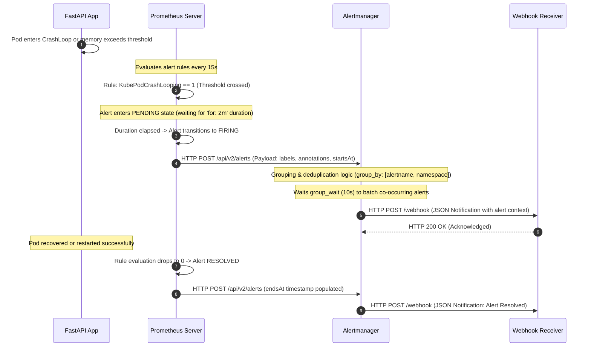

# Architecture: Kubernetes Observability Platform (`kube-obs`)

A comprehensive architectural breakdown of telemetry ingestion, storage, alert routing, visualization, and ingress networking.

---

## 1. System Architecture Overview

```mermaid
flowchart TD
    subgraph Client["External Clients / SRE Workstation"]
        BROWSER["HTTPS Browser / curl\n(/etc/hosts: *.local)"]
        WEBHOOK["External Webhook\nReceiver / Alert Endpoint"]
    end

    subgraph K8s["Kubernetes Cluster (Minikube runtime)"]
        subgraph IngressLayer["Ingress & Edge Routing"]
            NGINX["NGINX Ingress Controller\n(TLS Termination via Secrets)"]
        end

        subgraph ObsNamespace["Namespace: observability"]
            direction TB
            subgraph DataCollection["Telemetry Collection Agents"]
                NE["Node Exporter (DaemonSet)\nHost CPU, Memory, Disk, Net\nPort 9100"]
                KSM["kube-state-metrics (Deployment)\nK8s Objects, Pod Phases, Replicas\nPort 8080"]
                CADV["cAdvisor / Kubelet\nContainer Cgroup Metrics\nPort 10250"]
                APP["FastAPI Demo Workload (Deployment)\nCustom /metrics Endpoint\nPort 8080"]
            end

            subgraph StorageEngine["Core Engine & Persistence"]
                PROM["Prometheus Server (StatefulSet)\n• TSDB Engine\n• Rule Evaluation Engine\n• Scrape Scheduler\nPVC: prometheus-db"]
            end

            subgraph Alerting["Incident Lifecycle"]
                AM["Alertmanager (StatefulSet)\n• Alert Grouping & Dedup\n• Route Trees\n• Webhook Dispatcher"]
            end

            subgraph Visuals["Visualization as Code"]
                GF["Grafana (Deployment)\n• PromQL Dashboards\n• k8s-sidecar ConfigMap Watcher\nPVC: grafana-storage"]
            end
        end
    end

    %% Ingress routing
    BROWSER -->|HTTPS:443 grafana.local| NGINX
    BROWSER -->|HTTPS:443 prometheus.local| NGINX
    BROWSER -->|HTTPS:443 app.local| NGINX
    NGINX -->|HTTP:3000| GF
    NGINX -->|HTTP:9090| PROM
    NGINX -->|HTTP:8080| APP

    %% Telemetry collection
    PROM -->|Scrape :9100| NE
    PROM -->|Scrape :8080| KSM
    PROM -->|Scrape :10250| CADV
    PROM -->|Scrape :8080/metrics| APP

    %% Alerting and visualization
    PROM -->|Fire Alerts (HTTP:9093)| AM
    AM -->|Dispatch Notifications| WEBHOOK
    GF -->|PromQL Queries (HTTP:9090)| PROM

    style K8s fill:#0f172a,stroke:#38bdf8,stroke-width:2px,color:#f8fafc
    style ObsNamespace fill:#1e293b,stroke:#64748b,stroke-width:1px,color:#f8fafc
    style IngressLayer fill:#1e1b4b,stroke:#818cf8,stroke-width:1px,color:#f8fafc
    style StorageEngine fill:#022c22,stroke:#10b981,stroke-width:1px,color:#f8fafc
    style Alerting fill:#450a0a,stroke:#f87171,stroke-width:1px,color:#f8fafc
    style Visuals fill:#3b1e08,stroke:#fb923c,stroke-width:1px,color:#f8fafc
```

---

## 2. Ingestion & Scrape Pipelines

The telemetry ingestion layer functions as a pull-based model executed by Prometheus on a strict 15-second scrape interval:

### A. Infrastructure Metrics (Node Exporter)
* Deployed as a Kubernetes `DaemonSet` on every cluster node.
* Bypasses container cgroup virtualization to read directly from the host `/proc` and `/sys` filesystems.
* Exposes critical hardware metrics: CPU core states (`idle`, `system`, `user`, `iowait`), memory allocation (buffers, cache, swap, dirty memory), disk read/write throughput, and network interface packet counters.

### B. Cluster Orchestration State (Kube-State-Metrics)
* Listens to the Kubernetes API server via a dedicated read-only `ClusterRole`.
* Translates raw API objects into clean Prometheus metrics:
  * `kube_deployment_status_replicas_available`
  * `kube_pod_status_phase`
  * `kube_pod_container_status_restarts_total`
  * `kube_pod_container_status_waiting_reason{reason="CrashLoopBackOff"}`

### C. Application Runtime Telemetry (FastAPI Workload)
* The instrumented microservice uses custom middleware to intercept incoming HTTP traffic.
* Exposes standard Prometheus text metrics at `/metrics`:
  * `app_uptime_seconds` (Gauge): Current running time since process initialization.
  * `app_info` (Gauge): Version, environment, and tooling metadata.
  * `app_http_requests_total` (Counter): Multi-dimensional request count partitioned by `method`, `endpoint`, and `status`.

---

## 3. Alert Routing & Notification Architecture



---

## 4. Ingress Networking & TLS Termination

Access to the platform is unified through an **NGINX Ingress Controller**:
* **TLS Termination**: Certificates stored in Kubernetes TLS Secrets (`tls-grafana`, `tls-prometheus`, `tls-app`) terminate HTTPS traffic at the cluster ingress boundary with modern cipher suites.
* **SNI Routing**: Server Name Indication routes traffic based on virtual hostnames:
  * `grafana.local` → Grafana service port 3000
  * `prometheus.local` → Prometheus service port 9090
  * `app.local` → Demo microservice port 8080
* **Security Controls**: Ingress annotations enforce request size limits, connection timeouts, and SSL redirect headers.

