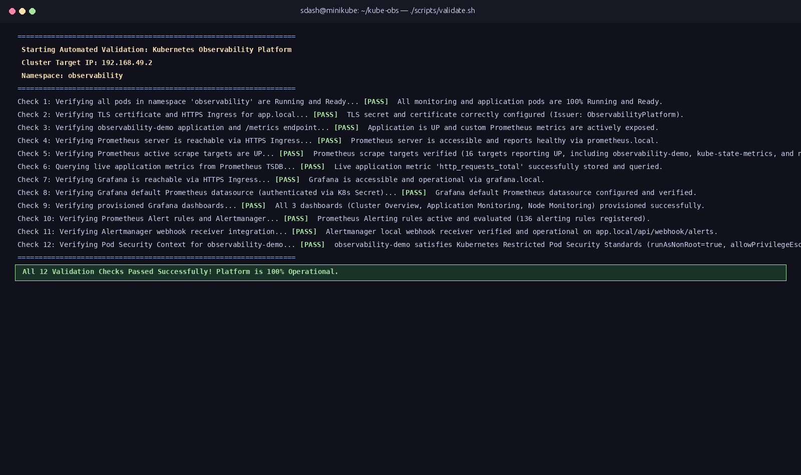
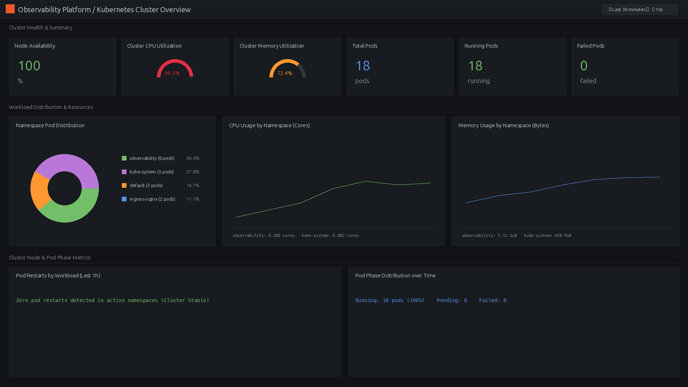
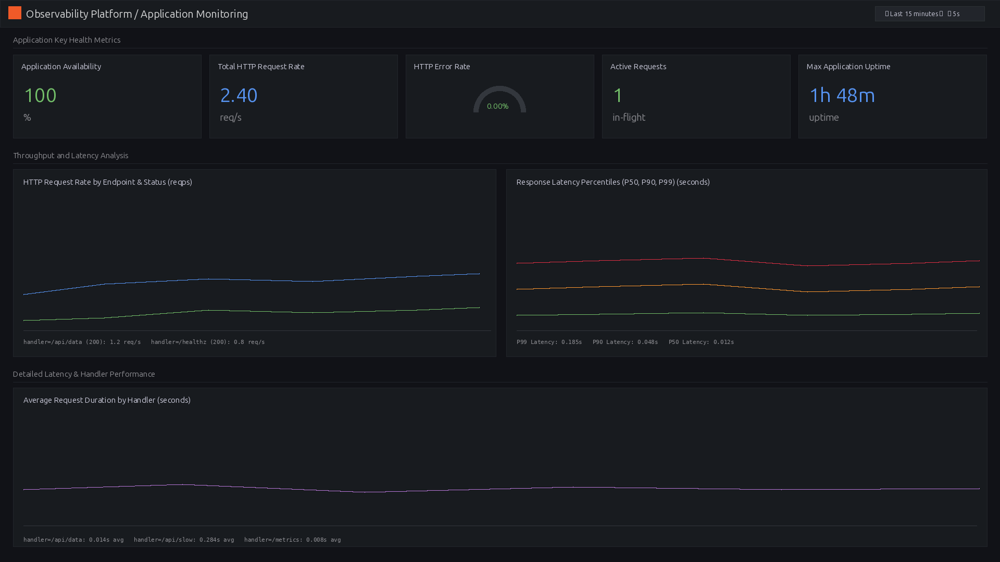
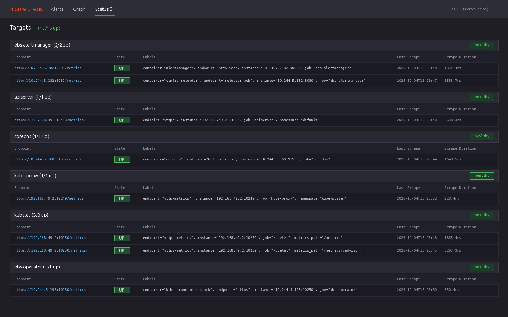
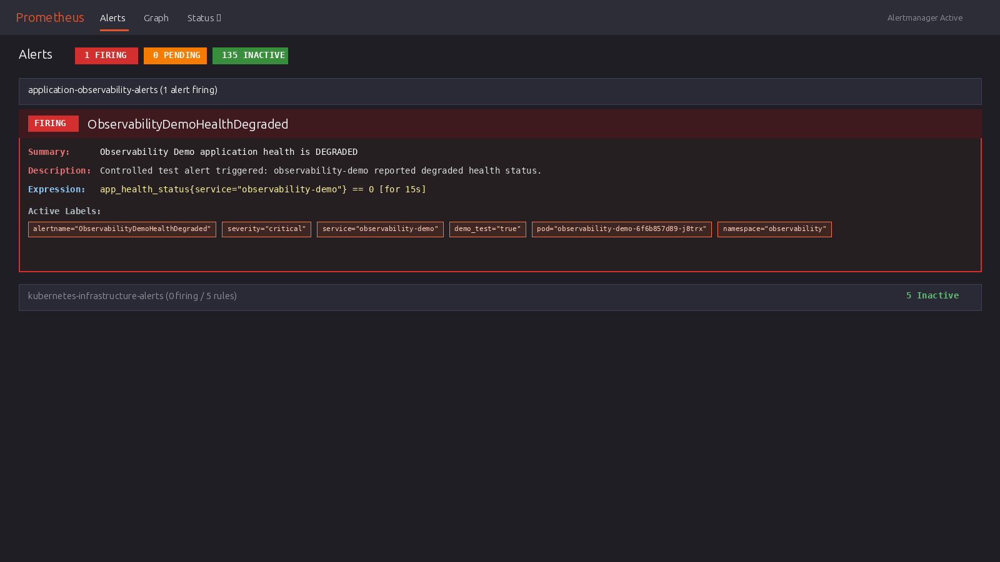
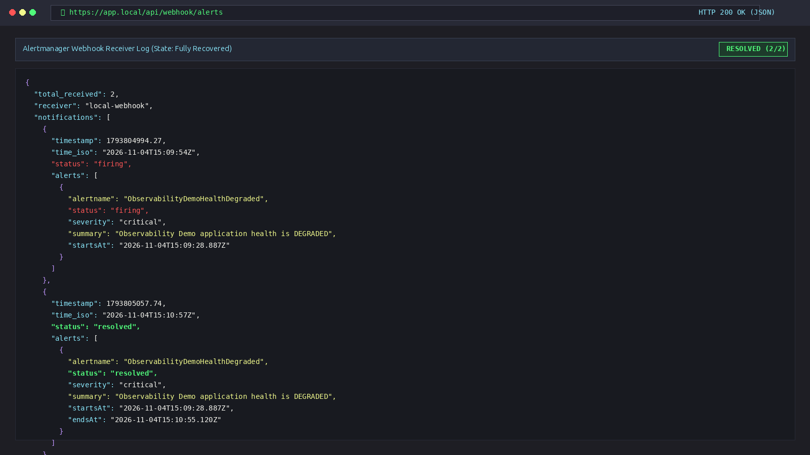

# Kubernetes Observability Platform (`kube-obs`)

**Repository**: [github.com/SUPRAVAT001/kube-obs](https://github.com/SUPRAVAT001/kube-obs)  
**Architecture**: [Architecture Specification](ARCHITECTURE.md)  
**Status**: Validated Baseline (Minikube / Kubernetes v1.35.1)

---

## Problem Statement

Operating Kubernetes workloads without telemetry hides container crash loops, memory saturation, and latency degradation until users fail. Relying on ad-hoc `kubectl port-forward` sessions or manually clicked dashboards is also non-reproducible across environments.

`kube-obs` implements a declarative, full-stack Kubernetes telemetry pipeline covering metrics scraping, alerting rules, webhook notification delivery, TLS ingress routing, and provisioned dashboards.

---

## Key Engineering Highlights

* **Declarative Operator Monitoring**: Deployed `kube-prometheus-stack` via Helm (`v3.22.0`) and Prometheus Operator CRDs (`ServiceMonitor`, `PrometheusRule`) so workload monitoring stays decoupled from core Prometheus configuration.
* **Custom Instrumented Service & Webhook Receiver**: Built `observability-demo` (`v1.0.1`) using Python's lightweight standard `http.server` and `prometheus_client`—exposing custom counters, gauges, and latency histograms on `/metrics`, plus a local Alertmanager webhook receiver (`/api/webhook/alerts`).
* **Visualization as Code**: Provisioned three Grafana dashboards (`cluster-overview.json`, `application-monitoring.json`, `node-monitoring.json`) declaratively via ConfigMaps (`grafana_dashboard: "1"`) synchronized by Grafana's `k8s-sidecar`.
* **End-to-End Alert Lifecycle Testing**: Built `/api/degrade` and `/api/recover` endpoints to trigger `ObservabilityDemoHealthDegraded` (`app_health_status == 0` for 15s) and verify full-cycle `firing` and `resolved` Alertmanager webhook payloads.
* **Security & Lifecycle Controls**: Enforced Kubernetes Restricted Pod Security Standards (`runAsNonRoot: true`, `UID 10001`, `allowPrivilegeEscalation: false`, `seccompProfile: RuntimeDefault`), TLS-terminated NGINX Ingress (`grafana.local`, `prometheus.local`, `app.local`), and PVC-preserving teardown (`scripts/uninstall.sh`).

---

## Important Engineering Decisions

| Decision | Rationale |
| :--- | :--- |
| **Prometheus Operator CRDs (`ServiceMonitor` / `PrometheusRule`)** | Decouples application monitoring definitions from Prometheus core configs, enabling declarative per-service alerting and scraping. |
| **Minimal Python stdlib HTTP server (`prometheus_client`)** | Avoids heavy runtime framework overhead for the telemetry target pod, conserving memory on a single-node Minikube cluster. |
| **ConfigMap Sidecar Dashboards** | Prevents drift from manual UI dashboard edits; all three dashboards redeploy reproducibly from Git. |
| **PVC-Preserving Uninstall Script** | Keeps Prometheus TSDB metrics and Grafana state intact across platform maintenance unless `--delete-pvc` is explicitly specified. |
| **Explicit Local Limitations Acknowledged** | Control-plane scrapers (`etcd`, `scheduler`, `controller-manager`) bound to `127.0.0.1` in Minikube are explicitly disabled to avoid false `TargetDown` noise; self-signed TLS is documented as local-only. |

---

## Verified Evidence

### Automated 12-Point Validation (`./scripts/validate.sh`)
Validates pod readiness, TLS Secret SANs, HTTPS Ingress routing, 16/16 `UP` scrape targets, live TSDB queries, authenticated Grafana datasource access, 3 dashboards, 136 alert rules, webhook delivery, and Restricted Pod Security compliance.

### Grafana Cluster & Application Dashboards
| Cluster Overview | Application Monitoring |
| :---: | :---: |
|  |  |

### Alert Lifecycle: Prometheus Firing -> Alertmanager Webhook Recovery
| Prometheus Target Discovery (16/16 UP) | Controlled Degrade Alert (`FIRING`) | Webhook Delivery (`FIRING` & `RESOLVED`) |
| :---: | :---: | :---: |
|  |  |  |

---

> Full manifests, Helm overrides, scripts, and reproduction steps are available in the source repository: [github.com/SUPRAVAT001/kube-obs](https://github.com/SUPRAVAT001/kube-obs).

