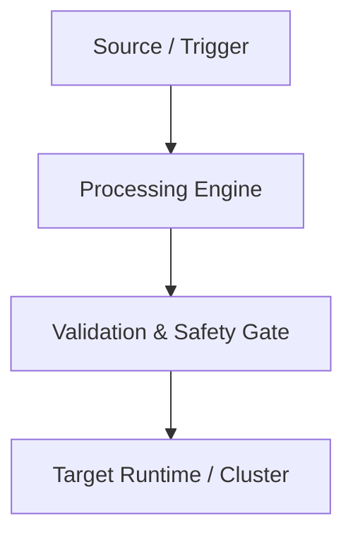

# [Project Title / Name]

**Repository**: [github.com/SUPRAVAT001/project-name](https://github.com/SUPRAVAT001/project-name)  
**Status**: [e.g., Production-Ready / Active Development / Validated Baseline]  
**Primary Domain**: [e.g., Cloud Infrastructure / GitOps / Observability / Platform Engineering]

---

## 1. Executive Summary & Problem Statement

### The Problem
* Detail the specific operational, reliability, or security friction that motivated this project.
* What happens without this platform in place? (e.g., silent failures, manual drift, security vulnerabilities).

### The Solution
* 2–3 sentences summarizing what was built, how it solves the problem, and its core operational philosophy.

---

## 2. Core Capabilities & Architectural Workflow

* Bullet points describing key technical capabilities.
* Mermaid workflow or sequence diagram illustrating end-to-end data/request flow.



---

## 3. Technology Stack & Component Inventory

| Layer | Component | Version | Role & Responsibility |
| :--- | :--- | :--- | :--- |
| **Compute / Orchestration** | [e.g., Kubernetes] | [Version] | [Responsibility] |
| **CI/CD / Automation** | [e.g., GitLab CI / Actions] | [Version] | [Responsibility] |
| **Packaging / IaC** | [e.g., Helm / Terraform] | [Version] | [Responsibility] |
| **Telemetry & Observability**| [e.g., Prometheus / Grafana]| [Version] | [Responsibility] |
| **Runtime Language** | [e.g., Python 3.12 / Go] | [Version] | [Responsibility] |
| **Security & Hardening** | [e.g., OPA / Non-root] | [Version] | [Responsibility] |

---

## 4. Key Architectural & Engineering Decisions

Document major trade-offs and decisions:

| Decision | Alternatives Considered | Rationale & Trade-off |
| :--- | :--- | :--- |
| **[Decision 1]** | [Alternative A, Alternative B] | [Why this choice was selected and what trade-offs were accepted] |
| **[Decision 2]** | [Alternative A, Alternative B] | [Why this choice was selected and what trade-offs were accepted] |

---

## 5. Implementation Details & Security Profile

* **Container / Workload Hardening**: Non-root UID, capability dropping, seccomp profiles, read-only root filesystems.
* **Network & Ingress**: Routing patterns, TLS termination, network policies.
* **Resource Optimization**: CPU/memory requests and limits, burst profiles.
* **Testing & Quality Gates**: Unit tests, integration tests, linting, simulation harnesses.

---

## 6. Real-World Troubleshooting & Debugging Cases

Document 1–2 real engineering failures diagnosed and resolved during development:

### Case 1: [Issue Title]
* **Symptom**: What failed, error messages, exit codes.
* **Root Cause Analysis (RCA)**: Underlying technical breakdown.
* **Resolution & Verification**: Exact fix applied and commit/test verification.

---

## 7. Verification Evidence & Demonstration Runbook

* Quantified verification results (e.g., pipeline execution times, test counts, drift recovery duration).
* Links to genuine screenshot evidence stored in `evidence/`.

| Evidence Asset | Metric / Event Captured | Reference Link |
| :--- | :--- | :--- |
| `screenshot-01.png` | [Description] | [`evidence/...`](#) |
| `screenshot-02.png` | [Description] | [`evidence/...`](#) |

---

## 8. Reproducibility & Local Quickstart

```bash
# Clone the repository
git clone https://github.com/SUPRAVAT001/project-name.git
cd project-name

# Run validation / local simulation
./scripts/validate.sh
```

